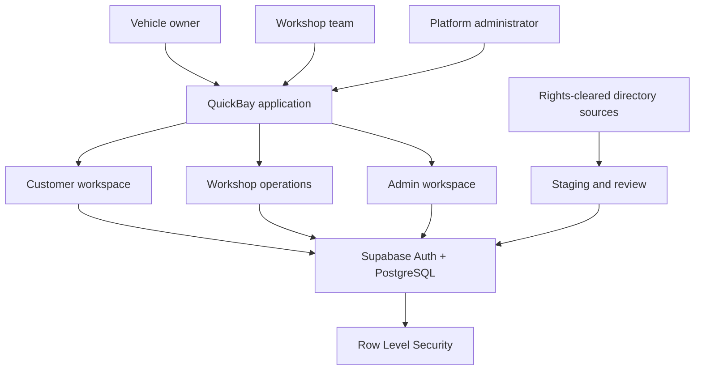

<div align="center">

# QuickBay

### Every Bay. Every Job. One Platform.

**The operating system and discovery layer for India's independent automotive workshops.**

<p>
  <a href="https://github.com/yoyo-0909/Quickbay"></a>
  
  
  
</p>

[Product overview](docs/PRODUCT_OVERVIEW.md) · [Architecture](docs/ARCHITECTURE.md) · [Roadmap](docs/ROADMAP.md) · [Setup](SUPABASE_SETUP.md) · [Contributing](CONTRIBUTING.md)

</div>

---

## The idea

QuickBay is building a connected service experience for vehicle owners and a practical operations workspace for independent multi-brand workshops.

For customers, the goal is to make it easier to discover eligible workshops, request service, follow job progress and keep service records together. For workshop teams, QuickBay brings bookings, bays, job cards, technicians and service operations into one workflow.

The long-term ambition is to make fragmented local automotive service easier to discover, manage and trust—starting with a focused regional pilot and expanding only as data quality and partner coverage are validated.

## Product areas

| Workspace | Capabilities represented in the codebase |
|---|---|
| **Customer** | Profile and vehicle garage, workshop discovery, booking requests, service tracking, service history, saved workshops, estimate responses, invoice summaries, support and feedback |
| **Workshop** | Booking queue, bay management, job cards, service-stage progression, technician directory, estimates, invoice register, inventory ledger and parts-return records |
| **Administration** | Platform overview, customer and booking views, workshop applications, partner directory, catalogue management, private feedback moderation, support and audit views |

> **Important:** A module in the interface does not mean every workflow has completed production QA. See [project status](#project-status) and the validation notes before treating a capability as launch-ready.

## How the platform fits together



## Technology

- **Application:** HTML, CSS and browser JavaScript, organised with supporting workflow modules.
- **Backend:** Supabase Auth and PostgreSQL.
- **Data protection:** Row Level Security (RLS), role-aware access and workshop membership scoping.
- **Maps and discovery:** OpenStreetMap-based discovery tooling, subject to source terms and attribution.
- **Data ingestion:** Python Overpass collector and a Node.js CSV importer for rights-cleared records.

See [architecture and trust boundaries](docs/ARCHITECTURE.md) for the system overview.

## Project status

<details open>
<summary><strong>Current development snapshot</strong></summary>

- Active development branch: `docs/professional-overhaul` (documentation-focused branch based on `work/quickbay-completion`).
- The Supabase project and core application schema are documented as connected; review the setup guide before applying any migration.
- Migrations `0001`–`0016` are documented in [SUPABASE_SETUP.md](SUPABASE_SETUP.md).
- The workshop directory must show only records whose source and public-display permissions are established.
- The 30,000+ workshop target is a sourcing goal, **not** a current directory count.
- Full interactive browser QA and authenticated end-to-end testing remain outstanding in the latest recorded validation notes.

</details>

### What is intentionally not enabled

- Payment gateway activation or financial transactions.
- Outbound SMS, email, push notifications or automated customer messaging.
- Phone OTP or phone-based sign-in.
- Unlicensed bulk imports or fabricated workshop listings.
- Automatic promotion of development work to production.

The in-app inbox/notification data is not an outbound messaging service. Invoice summaries and registers must not be presented as payment processing.

## Quick start

This repository contains a browser application and Supabase integration. The exact local setup depends on the checked-in application entry point and the Supabase project configuration.

1. Clone the repository and switch to the branch you want to inspect.
   ```bash
   git clone https://github.com/yoyo-0909/Quickbay.git
   cd Quickbay
   git checkout work/quickbay-completion
   ```
2. Install the Node dependencies.
   ```bash
   npm install
   ```
3. Review [SUPABASE_SETUP.md](SUPABASE_SETUP.md) before connecting an environment.
4. Configure only the public Supabase project URL and publishable/anon key in the browser configuration file.
5. Serve the application using your chosen static development server or preview environment.
6. Use dedicated test accounts and test workshop memberships for validation. Do not test with real customer records.

The current package manifest exposes the `import:workshops` script. The importer is an administrative data operation—not part of ordinary local startup.

## Workshop data: accuracy before scale

QuickBay's directory is only as useful as its source quality. Every imported record must have traceable provenance and documented rights for the intended use.

- Keep source, license, attribution and public-display permission with imported records.
- Stage and review records before they become visible.
- Keep third-party source attribution visible.
- Do not label a listing as QuickBay-verified unless the verification state actually supports that claim.
- Never fabricate business names, phone numbers, ratings, coordinates or coverage figures.

Read [DATA_SOURCING.md](DATA_SOURCING.md) before collecting or importing data.

## Security principles

- Never commit service-role keys, passwords, tokens or private credentials.
- Keep privileged Supabase operations server-side.
- Do not accept a privileged role from public signup metadata.
- Keep customer data scoped to its owner and workshop data scoped to active membership.
- Use the append-only inventory movement workflow rather than direct browser-side stock edits.
- Report suspected vulnerabilities privately; see [SECURITY.md](SECURITY.md).

## Documentation

| Document | Purpose |
|---|---|
| [Product overview](docs/PRODUCT_OVERVIEW.md) | Product vision, users and core journeys |
| [Architecture](docs/ARCHITECTURE.md) | Application layers, data boundaries and trust model |
| [Roadmap](docs/ROADMAP.md) | Staged delivery priorities and acceptance gates |
| [Supabase setup](SUPABASE_SETUP.md) | Auth, database, migrations and environment guidance |
| [Data sourcing](DATA_SOURCING.md) | Data provenance, licensing and import workflow |
| [Contributing](CONTRIBUTING.md) | Development and pull request expectations |
| [Security](SECURITY.md) | Credential handling and vulnerability reporting |

## Contributing

QuickBay is evolving. Before proposing a change, read [CONTRIBUTING.md](CONTRIBUTING.md), describe the problem clearly and include the smallest reproducible test case you can. Avoid committing secrets or real customer/workshop data.

## Project identity

**QuickBay** — Every Bay. Every Job. One Platform.

Built to help workshops run better and help vehicle owners find a clearer service experience.
