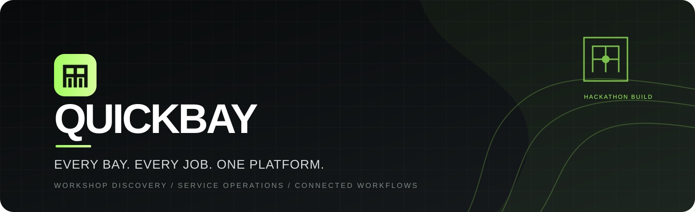

<!-- QuickBay repository front page -->

 

**Every Bay. Every Job. One Platform.**

A workshop discovery and service-operations platform designed to bring vehicle owners and independent multi-brand workshops into one connected experience.

[Product overview](docs/PRODUCT_OVERVIEW.md) · [Repository map](docs/REPOSITORY_MAP.md) · [Roadmap](docs/ROADMAP.md) · [Backend setup](SUPABASE_SETUP.md) · [Data sourcing](DATA_SOURCING.md)

---

## The problem we're solving

Independent automotive workshops are essential to everyday mobility, yet finding the right workshop and managing the service journey can still depend on fragmented calls, paper records and disconnected tools.

QuickBay is being built to make that experience clearer:

- **For vehicle owners:** discover workshops, organise vehicle details, request service and follow the work.
- **For workshop teams:** manage incoming requests and structure day-to-day service operations.
- **For platform operations:** govern partner onboarding and improve directory quality.

The product is being developed with a regional-first mindset. The priority is to validate the core experience with real workshop partners before making broad coverage claims.

## Three connected workspaces

<table>
<tr>
<td width="33%" valign="top">

### Customer

A clearer path from finding a workshop to understanding the service.

- Vehicle profile and garage
- Workshop discovery
- Map-based exploration
- Booking requests
- Service progress
- Service records

</td>
<td width="33%" valign="top">

### Workshop

A structured workspace for independent service teams.

- Booking queue
- Bay and job-card workflows
- Technician information
- Service-stage progression
- Estimate and invoice records
- Inventory workflow foundations

</td>
<td width="33%" valign="top">

### Administration

Tools for maintaining partner and platform quality.

- Workshop applications
- Partner directory
- Catalogue governance
- Customer and booking views
- Operational oversight

</td>
</tr>
</table>

> **Development status:** The repository contains a browser-based product prototype and backend integration scaffolding. A visible screen or demo workflow should not be interpreted as a production-ready feature. Live Supabase provisioning, permission validation and end-to-end QA are release requirements.

## Product flow

    VEHICLE OWNER                 QUICKBAY                 WORKSHOP
          │                          │                         │
          ├── Discover a workshop ──>│                         │
          ├── Request a service ─────>│── Booking request ─────>│
          │                          │                         │
          │<──── Service updates ────│<── Job progress ────────┤
          │                          │                         │
          └──── Service history ────>│<── Service records ─────┘

    Platform administration supports partner onboarding and directory governance.

## Technology

| Area | Current foundation |
|---|---|
| Frontend | HTML, CSS and browser JavaScript |
| Backend integration | Supabase client integration points |
| Authentication | Supabase Auth integration scaffold |
| Database | PostgreSQL schema and SQL migrations |
| Workshop discovery | OpenStreetMap / Overpass data collector |
| Directory import | Node.js CSV importer with source metadata |

The backend is **not yet connected to a provisioned live Supabase project** in the current default-branch setup. The deployed site remains a demo preview until the backend setup steps are completed and tested. See [Supabase setup](SUPABASE_SETUP.md).

## Repository structure

    Quickbay/
    ├── .github/
    │   ├── ISSUE_TEMPLATE/      # Bug and feature request templates
    │   ├── workflows/           # Lightweight source-quality checks
    │   └── PULL_REQUEST_TEMPLATE.md
    ├── assets/                  # QuickBay brand assets
    ├── docs/                    # Product, roadmap and repository guides
    ├── scripts/
    │   ├── fetch_osm_workshops.py
    │   └── import-workshops.mjs
    ├── supabase/
    │   └── migrations/          # Ordered database migrations
    ├── config.js                # Public browser configuration only
    ├── index.html               # Browser application
    ├── package.json             # Importer dependencies
    ├── DATA_SOURCING.md
    └── SUPABASE_SETUP.md

Start with the [repository map](docs/REPOSITORY_MAP.md) if you're new to the codebase.

## Run the browser preview locally

1. Clone the repository:

       git clone https://github.com/yoyo-0909/Quickbay.git
       cd Quickbay

2. Start a local static server:

       python -m http.server 4173

3. Open http://localhost:4173 in your browser.

The browser preview can be explored without running the directory importer. Backend-backed behaviour requires a configured Supabase project and the setup steps in [SUPABASE_SETUP.md](SUPABASE_SETUP.md).

## Workshop directory and data responsibility

The long-term sourcing target is **30,000+ genuine workshop records**. This is a target, not a current verified directory count.

QuickBay includes an OpenStreetMap collector and a CSV import path. Mapping coverage varies and collected records are candidates for review—not automatically verified partners.

- Preserve source attribution and license information.
- Check storage and public-display rights before importing any dataset.
- Review and deduplicate records before publishing them.
- Never fabricate business names, phone numbers, ratings or locations.
- Never bulk-copy restricted Google Maps content.

Read [DATA_SOURCING.md](DATA_SOURCING.md) before collecting or importing records.

## Security and operational boundaries

- Never commit service-role keys, tokens or private credentials.
- Keep privileged database operations server-side.
- Treat UI visibility as presentation, not authorization.
- Validate Row Level Security before connecting real users.
- Use dedicated test accounts and test workshop records.
- Payment processing and outbound messaging are not enabled by this repository setup.

See [SUPABASE_SETUP.md](SUPABASE_SETUP.md) for backend activation requirements.

## Development roadmap

The roadmap is organised around reliability, a regional workshop pilot, workshop operations, customer experience and controlled expansion.

[Read the delivery roadmap](docs/ROADMAP.md).

## Contributing

Bug reports, focused improvements and documentation contributions are welcome. Before opening a pull request:

1. Read [CONTRIBUTING.md](CONTRIBUTING.md).
2. Explain the user problem and expected behaviour.
3. Include screenshots for interface changes.
4. Keep changes focused and reproducible.
5. Never include secrets or real customer/workshop data.

## License

A repository-wide open-source license has not been specified. Until a license is added, do not assume that code or assets may be reused or redistributed without permission.

---

**QuickBay**

*Built to help workshops run better and vehicle owners navigate service with confidence.*

[View the repository](https://github.com/yoyo-0909/Quickbay)

