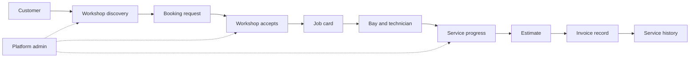

<div align="center">


<br />

<p><strong>THE OPERATING SYSTEM FOR INDEPENDENT AUTOMOTIVE WORKSHOPS</strong></p>

<p>
  <a href="https://quickbay.vercel.app"><strong>Live application</strong></a>
  &nbsp;·&nbsp;
  <a href="https://github.com/yoyo-0909/Quickbay/tree/work/quickbay-completion"><strong>Development branch</strong></a>
  &nbsp;·&nbsp;
  <a href="docs/ARCHITECTURE.md"><strong>Architecture</strong></a>
  &nbsp;·&nbsp;
  <a href="DATA_SOURCING.md"><strong>Data policy</strong></a>
</p>

<p>
  
  
  
  
  
</p>

<p><em>Every bay. Every job. One platform.</em></p>

</div>

---

## The idea

Independent workshops keep vehicles moving, but many still coordinate bookings, bays, technicians, estimates and customer updates across disconnected tools.

**QuickBay brings the workshop journey into one connected workspace.** It combines a customer-facing workshop directory with practical operations tools for the people running the service floor.

The current build is a **hackathon and product-validation prototype**. It is designed to demonstrate the experience and workflow, not to represent a production-ready automotive marketplace.

## Product at a glance

<table>
<tr>
<td width="50%" valign="top">

### Customer experience

- Discover automotive workshops
- Search by location and service
- View workshop details and public listing information
- Submit booking requests to eligible verified partners
- Track service progress
- Review estimates and invoice summaries
- Manage vehicles and service history
- Contact support and manage saved workshops

</td>
<td width="50%" valign="top">

### Workshop operations

- Manage incoming bookings
- Organise service bays
- Create and update digital job cards
- Assign technicians
- Move work through service stages
- Maintain service catalogues
- Track inventory and stock movements
- Prepare estimates and invoice records

</td>
</tr>
<tr>
<td width="50%" valign="top">

### Platform administration

- Review workshop applications
- Manage partner directory records
- Maintain service categories
- Maintain vehicle catalogues
- Moderate private customer feedback
- Review support requests
- Inspect analytics and audit activity

</td>
<td width="50%" valign="top">

### Hackathon demonstration

- Tiruvallur-focused workshop discovery
- Public listing details and map directions
- Browser-local sample invoice generation
- Printable demo invoice output
- Sample workflows for presenting the end-to-end product

</td>
</tr>
</table>

## How the workflow connects



A booking request is not a confirmed appointment until the workshop accepts it. Public third-party directory listings are for discovery and contact only; they are not automatically QuickBay partners.

## Technology

| Layer | Technology | Responsibility |
|---|---|---|
| Application | HTML, CSS, JavaScript | Customer, workshop and admin experiences |
| Database | Supabase Postgres | Application records and relational data |
| Authentication | Supabase Auth | Email and password authentication |
| Access control | PostgreSQL Row Level Security | Customer and workshop data boundaries |
| Maps and discovery | OpenStreetMap-based sources | Location-aware discovery and directions |
| Hosting | Vercel | Web application deployment |
| Source control | GitHub | Version history and collaboration |

## Repository map

```text
Quickbay/
├── index.html                  Application shell and interface
├── config.js                   Public Supabase client configuration
├── customer-experience.js      Customer directory and discovery
├── customer-billing.js         Customer invoice and billing views
├── workflows.js                Workshop and operational workflows
├── admin-catalogues.js         Admin catalogue management
├── directory-map.js            Workshop map behaviour
├── directory-map.css           Directory map styling
├── interaction-fixes.js        Interface interaction refinements
├── reviews.js                  Customer feedback workflows
├── support.js                  Support workflows
├── supabase/
│   └── migrations/              Database schema and policy history
├── scripts/                    Data import utilities
├── docs/
│   └── ARCHITECTURE.md          Product and technical architecture
├── assets/
│   └── quickbay-banner.svg      QuickBay repository identity
├── DATA_SOURCING.md             Directory sourcing and attribution policy
├── SUPABASE_SETUP.md            Backend setup and migration notes
└── README.md                    Project overview
```

## Run the project

The repository is a lightweight browser application. Open `index.html` through a local static server for the best experience; browser location and module behaviour can vary when opening files directly.

### 1. Clone

```bash
git clone https://github.com/yoyo-0909/Quickbay.git
cd Quickbay
```

### 2. Configure Supabase

Review `config.js` and `.env.example`. The browser application may use only the Supabase project URL and publishable/anon key.

Never put a Supabase service-role key, database password, private API token or other secret in frontend code or a public repository. The service-role placeholder in `.env.example` is documentation only; do not expose or use it in the browser.

### 3. Serve locally

For example, with Python installed:

```bash
python -m http.server 8000
```

Open [http://localhost:8000](http://localhost:8000).

### 4. Optional workshop data import

The repository includes a workshop import script. Read [DATA_SOURCING.md](DATA_SOURCING.md) and inspect the script before importing any records. Only use data that is permitted for the intended storage, display, commercial use and attribution.

## Prototype boundaries

QuickBay is currently being prepared as a hackathon prototype.

| Area | Current demonstration boundary |
|---|---|
| Workshop directory | Publicly sourced listings may be displayed with attribution and an unverified label |
| Partner status | A public listing is not a verified QuickBay partner |
| Booking | Requests are restricted by partner and service eligibility; a request is not an automatic confirmation |
| Billing | Demo invoices may be generated locally for presentation |
| Payments | No payment gateway, banking integration, UPI collection or payment processing is enabled |
| Notifications | Outbound SMS, email and push delivery are not enabled |
| Customer data | Use fictional data for demonstrations; do not upload real customer information without permission |

**Demo invoices are not tax invoices, payment requests, receipts or proof of payment.** They exist only to demonstrate a possible workflow.

## Security principles

- Keep privileged roles out of public signup flows.
- Enforce access boundaries in the database, not only in the interface.
- Keep customer and workshop records scoped to the correct authenticated user or membership.
- Never expose service-role credentials in browser code.
- Do not treat public business listings as approved partners.
- Do not import personal or business data without appropriate rights and permission.

See [SUPABASE_SETUP.md](SUPABASE_SETUP.md) for the backend setup notes and migration history.

## Project status

QuickBay is actively evolving as a prototype. The interface and workflow modules are being prepared for demonstration and validation.

Before any production launch, the project still needs full browser QA, authenticated customer and workshop end-to-end testing, data-source and partner verification, operational review, and a dedicated security review.

## Contributing

Contributions should keep the prototype focused, maintainable and safe. Read [CONTRIBUTING.md](CONTRIBUTING.md) before opening a pull request. Use the issue templates to report defects or propose improvements.

## Project links

- **Repository:** [github.com/yoyo-0909/Quickbay](https://github.com/yoyo-0909/Quickbay)
- **Development branch:** [work/quickbay-completion](https://github.com/yoyo-0909/Quickbay/tree/work/quickbay-completion)
- **Application:** [quickbay.vercel.app](https://quickbay.vercel.app)
- **Architecture:** [docs/ARCHITECTURE.md](docs/ARCHITECTURE.md)
- **Data sourcing policy:** [DATA_SOURCING.md](DATA_SOURCING.md)
- **Backend setup:** [SUPABASE_SETUP.md](SUPABASE_SETUP.md)

---

<div align="center">

**QUICKBAY**

<sub>Built to make workshop operations clearer, connected and easier to run.</sub>

</div>
