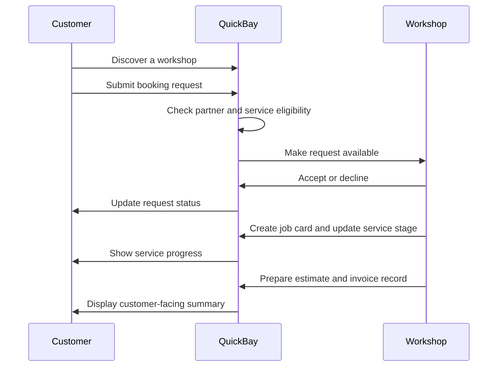

# QuickBay architecture

QuickBay is a browser-based automotive workshop discovery and operations prototype. The application is organised around three product surfaces: customer, workshop and platform administration.

## Product surfaces

| Surface | Primary responsibilities |
|---|---|
| Customer | Vehicle profile, workshop discovery, booking requests, service tracking, estimate responses, invoice summaries and support |
| Workshop | Booking queue, bays, job cards, technicians, service stages, catalogues, estimates and inventory |
| Administration | Workshop onboarding, partner status, service and vehicle catalogues, moderation, support and audit views |

## Request lifecycle

A request remains a request until the workshop accepts it. Public directory records are discovery-only unless the workshop completes the required onboarding and verification.

## Application structure

The project uses a lightweight HTML/CSS/JavaScript application rather than a large frontend framework.

| File | Responsibility |
|---|---|
| `index.html` | Application shell, layout and page composition |
| `config.js` | Public Supabase client configuration |
| `customer-experience.js` | Customer directory, discovery and customer-facing workflows |
| `customer-billing.js` | Customer invoice and billing views |
| `workflows.js` | Workshop operations and service workflows |
| `admin-catalogues.js` | Administrative catalogues |
| `directory-map.js` | Map and location interactions |
| `directory-map.css` | Directory-specific styling |
| `interaction-fixes.js` | Interaction refinements |
| `reviews.js` | Feedback and review workflows |
| `support.js` | Support workflows |

## Backend boundaries

Supabase provides authentication and PostgreSQL persistence. Row Level Security is used to enforce access boundaries for customer and workshop records.

- Public browser configuration contains only the project URL and publishable/anon key.
- Privileged keys must never be shipped to the browser.
- Workshop access depends on active workshop membership, not merely a role label.
- Customer records must remain scoped to the authenticated customer.
- Public directory listings must not be treated as verified partners.
- Booking requests must enforce partner and active-service eligibility in the database.

See [SUPABASE_SETUP.md](../SUPABASE_SETUP.md) for the migration and environment notes.

## Directory data

Workshop discovery can combine public directory information and approved partner records. Each source must be reviewed for its storage, display, attribution and commercial-use conditions.

A public listing is not a QuickBay endorsement. Ratings, contact details, addresses and service descriptions can change and should be confirmed with the business. See [DATA_SOURCING.md](../DATA_SOURCING.md).

## Hackathon billing boundary

The prototype may generate fictional invoices for demonstration. Demo invoice data is local to the browser and must be clearly labelled as non-transactional.

There is no payment gateway, banking integration, UPI collection or payment processing in the hackathon scope.

## Production readiness

The prototype is not a production release. Before launch, complete:

1. Browser QA across desktop and mobile layouts.
2. Authenticated customer and workshop end-to-end tests.
3. Database policy and function review.
4. Directory sourcing and partner verification review.
5. Accessibility and performance checks.
6. Security review and operational monitoring.
