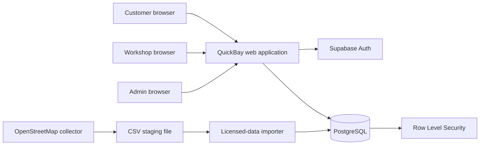

# QuickBay — Architecture

## System context

QuickBay is a browser-based application backed by Supabase. The repository contains the customer, workshop and administration experiences, supporting JavaScript workflow modules, SQL migrations and data-ingestion utilities.

## Application layer

The application is built from HTML, CSS and browser JavaScript. The main page coordinates the interface and loads supporting modules for workflow extensions, support, feedback, catalogues, customer billing views, directory maps and interaction fixes.

The interface includes three role-oriented workspaces:

- **Customer:** profile, garage, workshop discovery, bookings and service information.
- **Workshop:** bookings, bays, job cards, technicians and operational records.
- **Admin:** platform oversight, partner applications, directory and catalogue governance.

UI visibility is not a security boundary. Database policies must independently enforce every permission.

## Backend and access control

Supabase provides authentication and PostgreSQL storage. The documented schema includes profiles, workshops, workshop membership, vehicles, services, bookings, bays, technicians, job cards, estimates, invoices, inventory, support and audit-related records.

Security expectations:

- Email/password is the only authentication method.
- Public registration must not choose privileged roles.
- Customer rows are scoped to the authenticated customer.
- Workshop access is scoped through active workshop membership.
- Inventory changes use the audited stock-movement function; the browser must not directly mutate ledger history.
- Private feedback and support data must remain private to the permitted parties.
- Privileged service-role credentials must never be shipped to the browser.

See [SUPABASE_SETUP.md](../SUPABASE_SETUP.md) for migration history and operational notes.

## Directory data pipeline

The repository includes:

1. An OpenStreetMap/Overpass collector that discovers named automotive-service points of interest.
2. A CSV import process for source-cleared data.
3. A Supabase import batch record and source-attributed workshop records.
4. A review/claim process before a listing is represented as an approved QuickBay partner.

The collector is not a completeness guarantee. OpenStreetMap coverage varies. The importer must only be used when the source license explicitly permits storage and public display.

## Trust boundaries

| Boundary | Required control |
|---|---|
| Browser → database | RLS and authenticated access |
| Customer → customer data | Owner-scoped policies |
| Workshop → workshop data | Active membership checks |
| Public signup → roles | Server/database-controlled role assignment |
| Import file → public directory | License check, provenance and review |
| Browser → privileged operation | Server-side or restricted database function |
| Invoice record → money movement | No payment processing is implied or enabled |

## Environments and release flow

Keep development, preview and production separate. Validate schema changes and authenticated user journeys in a dedicated test environment before release. Do not merge or promote a development branch without explicit release approval.

## Known validation gap

The latest repository notes report JavaScript syntax checks and preview build success, while full interactive browser QA and authenticated end-to-end testing remain outstanding. Re-run validation after meaningful changes and update this note with reproducible evidence.
